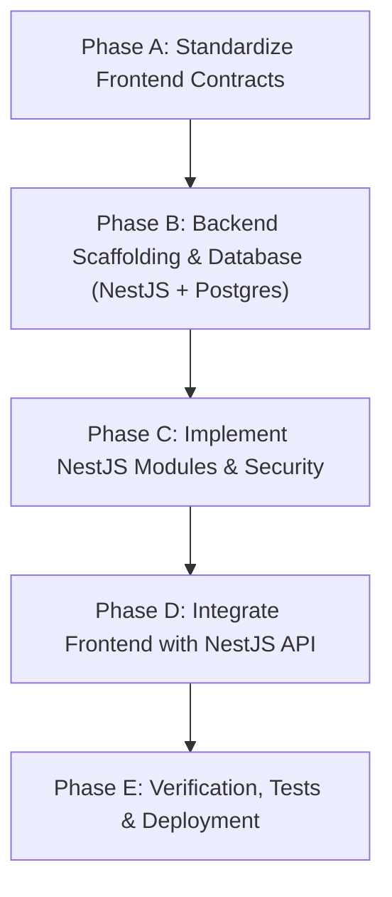

# HelpDesk Project: Revised Game Plan & Architecture Review

A comprehensive review and transition roadmap moving from the **Milestone 1 Frontend Prototype** (Vue 3 + Pinia + `json-server`) to the target full-stack architecture (**Vue 3 + NestJS + PostgreSQL via Prisma ORM**).

---

## 1. Executive Summary

The initial prototype plan laid out in `Docs/Game_Plan.md` successfully establishes client-side patterns: Vue 3 Composition API, strict TypeScript, Pinia for cross-route session management, and route navigation guards. 

However, transitioning to the production stack (**NestJS + PostgreSQL 16 + Prisma**) introduces critical discrepancies in **data contracts, authentication workflows, ID generation, and system audit event persistence**. This document details these differences and defines a step-by-step revised game plan to align both frontend and backend seamlessly without requiring extensive rewrites later.

---

## 2. Architecture Comparison

| Component | Prototype (M1) | Production Target (M2 - M5) |
| :--- | :--- | :--- |
| **Frontend** | Vue 3 (`<script setup lang="ts">`), Vite, Vue Router, Pinia | Same: Vue 3, Vite, Vue Router, Pinia |
| **API Layer** | `json-server` (mock REST server on port 3000) | NestJS (modular REST API with DTO validation & Swagger) |
| **Database** | `db.json` (flat file) | PostgreSQL 16 via Prisma ORM |
| **Auth & Security** | Plaintext user lookups via `api.getUsers()` | JWT (`accessToken`), `bcrypt` hashing, HTTP Bearer auth |
| **Role-Based Access** | Frontend router checks only (`meta.roles`) | Dual-layer: Frontend router guards + NestJS `RolesGuard` |
| **ID Generation** | Client-side helper (`getNextId()`) | Database sequence (`SERIAL` autoincrement / Prisma) |
| **Activity Logs** | Manually pushed comment objects from client | Backend service transactions with `isSystem: true` |

---

## 3. Key Discrepancies & Alignment Matrix

### 3.1 Field Naming & Data Contracts
The prototype used mixed PascalCase/camelCase and temporary typos. The NestJS backend and PostgreSQL database require clean, standardized camelCase attributes and uppercase enum constants.

| Model | Prototype Fields (`db.json` / `src/Data/`) | Target Field Name (Postgres / NestJS / Prisma) | Notes |
| :--- | :--- | :--- | :--- |
| **Ticket** | `TicketID` | `id: number` | Standardized primary key |
| **Ticket** | `Name` | `title: string` | Matches course user story definitions |
| **Ticket** | `Stage` (`'Opened'`, `'In Progress'`, etc.) | `status: TicketStatus` (`'OPEN'`, `'IN_PROGRESS'`, `'RESOLVED'`, `'CLOSED'`, `'CANCELLED'`) | Standard enum uppercase strings |
| **Ticket** | `Priority` (`'Low'`, `'Medium'`, `'High'`) | `priority: TicketPriority` (`'LOW'`, `'MEDIUM'`, `'HIGH'`) | Standard enum uppercase strings |
| **Ticket** | `CreateAt` / `UpdatedAt` | `createdAt: string` / `updatedAt: string` | Standard camelCase timestamps |
| **Ticket** | `CreateBy` / `Assignto` | `authorId: number` / `assignedToId?: number` | Clean relational foreign keys |
| **Category** | `CategroyID` *(typo)* | `id: number` | Fixes typo and standardizes ID |
| **Category** | `name` / `Description` | `name: string` / `description?: string` | Standard camelCase |
| **Comment** | `CommentID` | `id: number` | Standardized primary key |
| **Comment** | `creatAt` *(typo)* | `createdAt: string` | Fixes typo and standardizes timestamp |
| **Comment** | `AuthorID` / `TicketID` | `authorId: number` / `ticketId: number` | Clean relational foreign keys |
| **Comment** | `Message` / `SystemMessage` | `content: string` / `isSystem: boolean` | Standard naming convention |

---

### 3.2 Authentication & Authorization

* **Current Prototype:** Login queries `api.getUsers()` and checks user credentials client-side.
* **Target Architecture:**
  1. `POST /api/auth/register` creates a user with `role: 'CLIENT'` and stores a `bcrypt`-hashed password.
  2. `POST /api/auth/login` validates credentials and returns `{ accessToken: string, user: User }`.
  3. The Vue app stores `accessToken` in `localStorage` and loads it into `authStore`.
  4. Every outgoing request in `src/services/api.ts` attaches the header: `Authorization: Bearer <accessToken>`.
  5. `GET /api/auth/me` validates the token and restores the active session on page reload.

---

### 3.3 Database Sequences vs Client ID Generation

* **Current Prototype:** `getNextId(endpoint)` makes an extra network call to calculate `Math.max(ids) + 1`.
* **Target Architecture:** PostgreSQL automatically handles primary keys (`SERIAL`). The frontend must omit `id` when creating new entities (`POST /api/tickets`), and the database returns the generated record with its assigned `id`.

---

### 3.4 Immutable System Activity Events

* **Current Prototype:** Client updates ticket status and manually calls `api.addComment(...)` with system text.
* **Target Architecture:** When `PATCH /api/tickets/:id/status` or `PATCH /api/tickets/:id/claim` is called, the NestJS service updates the ticket and inserts an audit record (`isSystem: true`) within a single database transaction (`prisma.$transaction`). This ensures clients and technicians cannot tamper with, forge, or delete activity history.

---

## 4. Aligned TypeScript Interfaces (`src/Data/`)

Update your data contracts to reflect the target schema:

### `User.ts`
```ts
export type Role = 'CLIENT' | 'TECHNICIAN' | 'ADMIN'

export interface User {
  id: number
  username: string
  role: Role
  createdAt?: string
}
```

### `Categories.ts`
```ts
export interface Category {
  id: number
  name: string
  description?: string
  _count?: {
    tickets?: number
  }
}
```

### `Ticket.ts`
```ts
import type { User } from './User'
import type { Category } from './Categories'

export type TicketStatus = 'OPEN' | 'IN_PROGRESS' | 'RESOLVED' | 'CLOSED' | 'CANCELLED'
export type TicketPriority = 'LOW' | 'MEDIUM' | 'HIGH'

export interface Ticket {
  id: number
  title: string
  description?: string
  status: TicketStatus
  priority: TicketPriority
  categoryId: number
  category?: Category
  authorId: number
  author?: User
  assignedToId?: number
  assignedTo?: User
  closedAt?: string
  createdAt: string
  updatedAt: string
}
```

### `Comment.ts`
```ts
import type { User } from './User'

export interface Comment {
  id: number
  ticketId: number
  authorId?: number
  author?: User
  content: string
  isSystem: boolean
  createdAt: string
}
```

---

## 5. Revised Phased Implementation Roadmap



### Phase A: Standardize Frontend Contracts & Mock Data
1. Update `src/Data/` types to match the aligned contracts above.
2. Update `db.json` keys to match the new schema (`id`, `title`, `status`, `priority`, `categoryId`, `authorId`, `assignedToId`, `isSystem`, `content`).
3. Update components and views to reference new properties (e.g., `ticket.title` instead of `ticket.Name`, `ticket.status` instead of `ticket.Stage`).
4. Run `npm run type-check` (`vue-tsc --build`) to ensure zero type errors.

---

### Phase B: Backend Scaffolding & Database Setup
1. **Initialize NestJS project** (e.g. in a sibling `api/` or `server/` folder).
2. **Setup Docker Compose for PostgreSQL 16:**
   ```yaml
   services:
     postgres:
       image: postgres:16-alpine
       restart: always
       environment:
         POSTGRES_USER: helpdesk
         POSTGRES_PASSWORD: password123
         POSTGRES_DB: helpdesk_db
       ports:
         - "5432:5432"
       volumes:
         - pgdata:/var/lib/postgresql/data
   volumes:
     pgdata:
   ```
3. **Configure Prisma ORM:**
   * Define models: `User`, `Category`, `Ticket`, `Comment`.
   * Configure relationships:
     * `Category` 1-N `Ticket`
     * `User` 1-N `Ticket` (`ticketsAuthored`, `ticketsAssigned`)
     * `Ticket` 1-N `Comment` (with cascade delete on tickets)
   * Run initial migration: `npx prisma migrate dev --name init`.
4. **Seed Database (`prisma/seed.ts`):**
   * Create default users (`admin`, `tech`, `client`) with hashed passwords.
   * Create default categories (`Network`, `Hardware`, `Software`, `Account & Access`).

---

### Phase C: NestJS Modules & Security
1. **`AuthModule` & Guards:**
   * Passwords hashed via `bcrypt`.
   * JWT generation on login and registration.
   * `JwtAuthGuard` and `RolesGuard` protecting routes via `@Roles('ADMIN', 'TECHNICIAN')` decorator.
2. **`CategoriesModule`:**
   * CRUD endpoints with admin-only restrictions on mutations.
   * Prevent deletion if active tickets exist under the category.
3. **`TicketsModule`:**
   * Pagination (`page=1&limit=10`), search keywords, and filter query parameters (`status`, `priority`, `categoryId`).
   * Role-based visibility: Clients retrieve only their own tickets; Technicians and Admins query all tickets.
   * Status change endpoint (`PATCH /api/tickets/:id/status`) that runs a Prisma transaction creating an immutable `Comment` with `isSystem: true`.
4. **`CommentsModule`:**
   * Comment creation for active tickets (rejection if status is `CLOSED` or `CANCELLED`).
   * Restrict deletion: comments can only be removed by author or Admin; `isSystem: true` events can never be deleted.

---

### Phase D: Frontend Integration Layer
1. **Update `src/services/api.ts`:**
   * Attach Bearer token from `localStorage` to all requests.
   * Point `VITE_API_URL` to `http://localhost:3000/api`.
   * Remove mock helpers like `getNextId()`.
2. **Update `src/stores/auth.ts`:**
   * Store both `currentUser` and `accessToken`.
   * Save token to `localStorage` on login; remove on logout.
   * Add `initAuth()` action calling `GET /api/auth/me` on initial app mount.
3. **Switch Views from Mock API to NestJS:**
   * Connect `MyTicketsView.vue`, `TicketQueueView.vue`, `TicketDetailView.vue`, `CategoriesView.vue`, and `UsersView.vue`.

---

### Phase E: Verification & Submission Checklist
1. **Client-side & Server-side Form Validation:**
   * DTO validation with `class-validator` in NestJS.
   * Vue reactive form validation feedback.
2. **Error & Loading States:**
   * Handle HTTP 400, 401, 403, and 404 responses gracefully in the UI.
3. **Automated Testing:**
   * Unit tests for critical composables and components (`vitest`).
   * End-to-End API tests (`tickets.e2e-spec.ts` in NestJS).
4. **Containerization & CI:**
   * Multi-stage Docker builds for `web` and `api`.
   * GitHub Actions workflow validating lint, type-checks, migrations, and builds.

